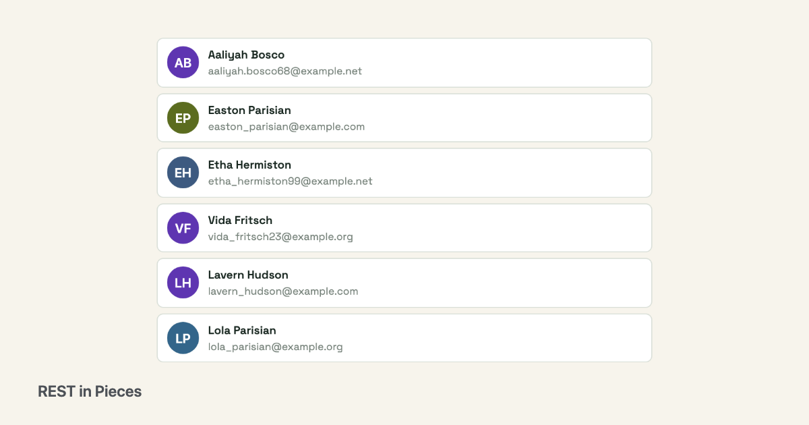
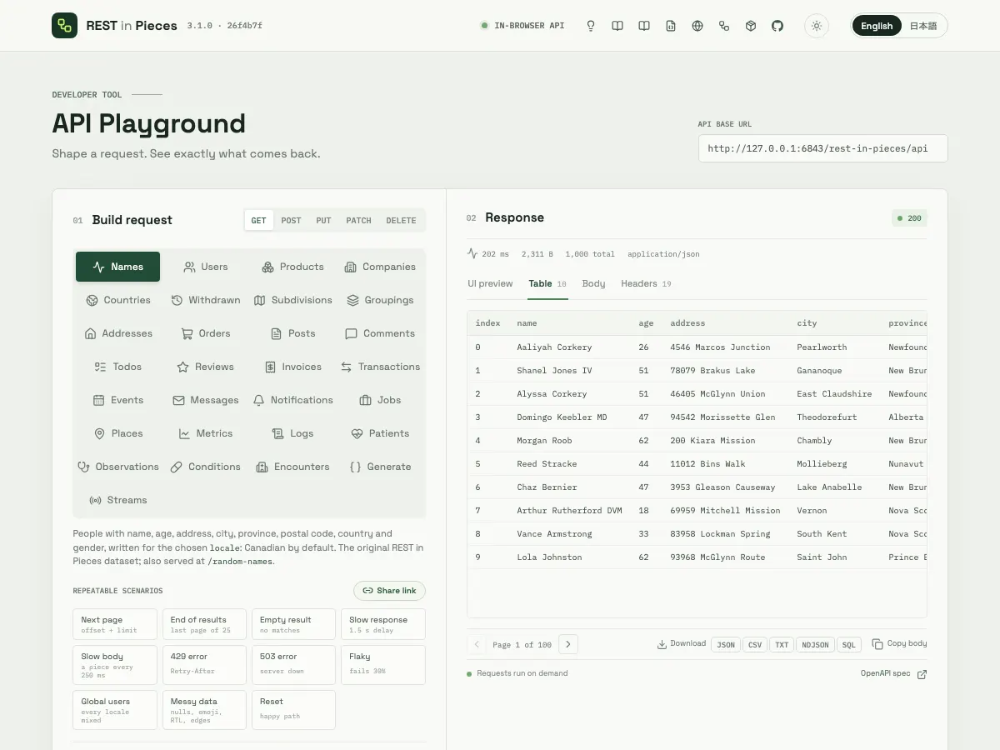
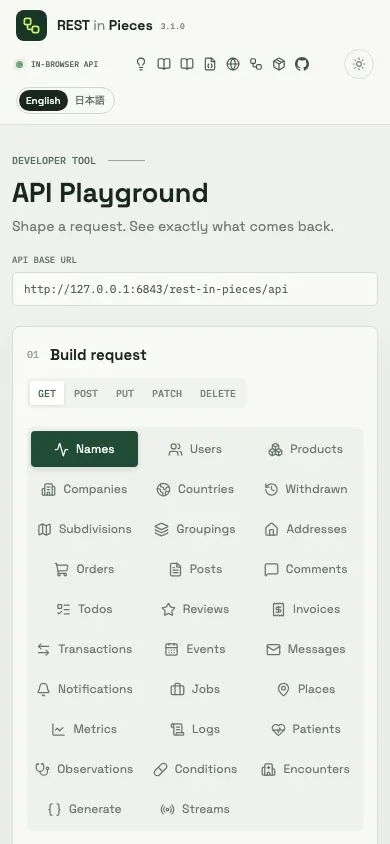
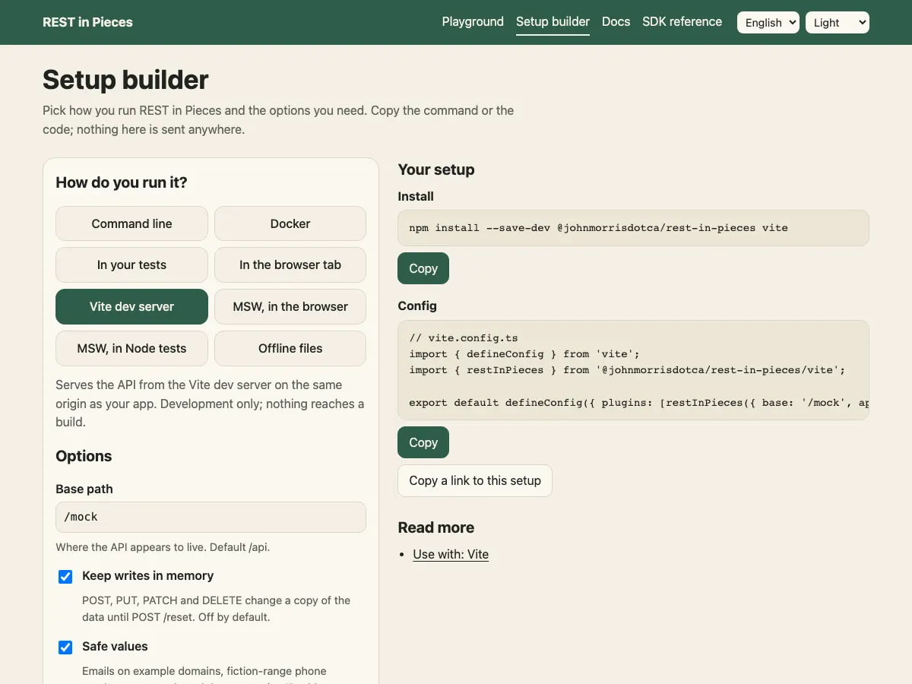
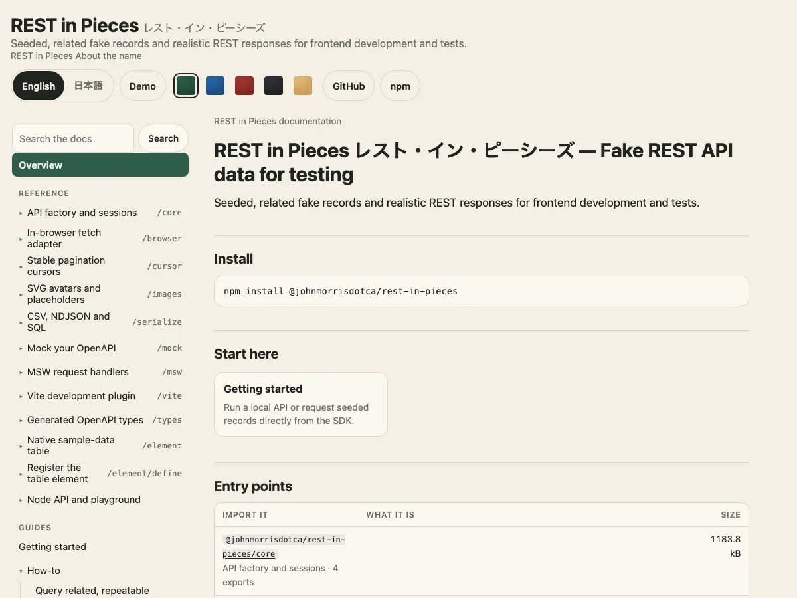
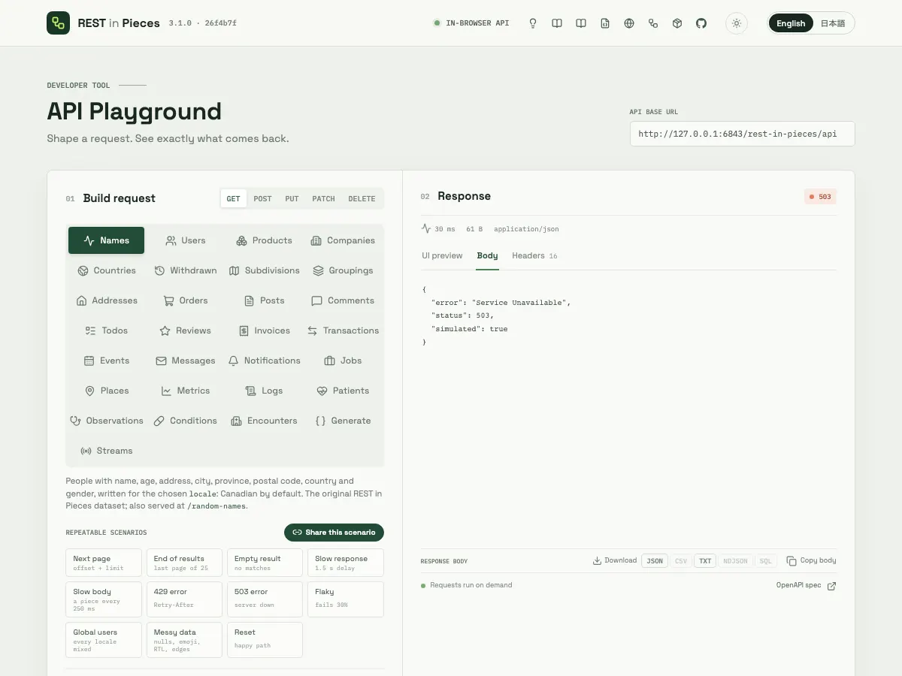
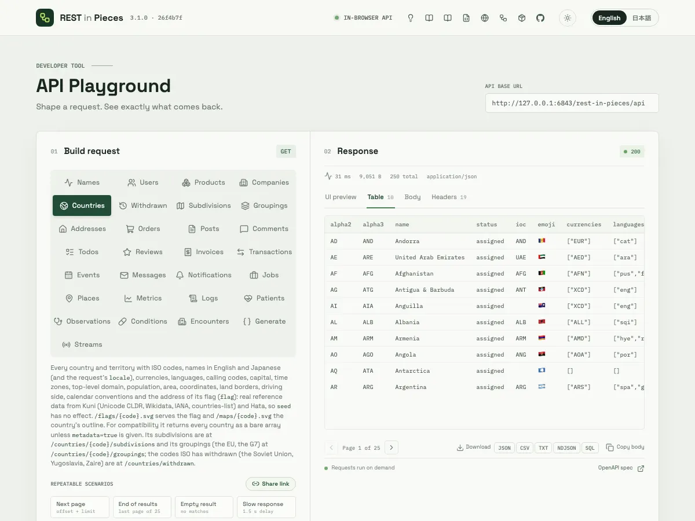
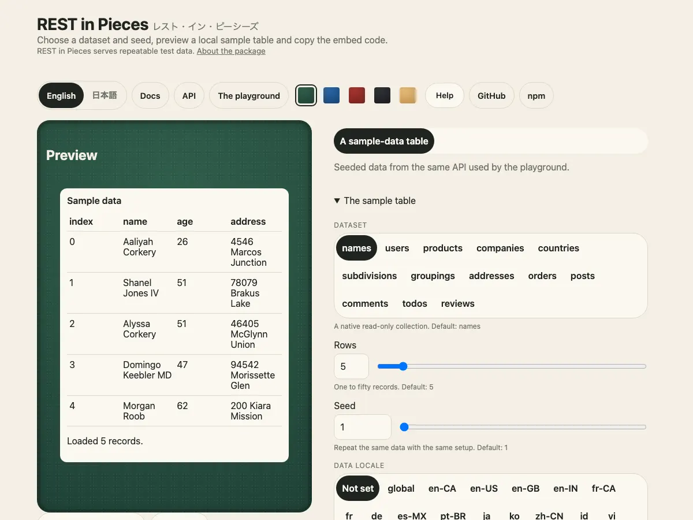

<p align="center"><a href="https://spxis.github.io/rest-in-pieces/"><picture><source media="(prefers-color-scheme: dark)" srcset="https://raw.githubusercontent.com/spxis/rest-in-pieces/main/docs/images/thumbnail-dark.png"></picture></a></p>

# REST in Pieces — Fake REST API data for testing

[](https://github.com/spxis/rest-in-pieces/actions/workflows/ci.yml)
[](https://spxis.github.io/rest-in-pieces/)
[](https://www.npmjs.com/package/@johnmorrisdotca/rest-in-pieces)


<a href="https://spxis.github.io/rest-in-pieces/docs/api/main/index.html"></a>
<a href="https://www.npmjs.com/package/@johnmorrisdotca/rest-in-pieces#provenance"></a>
[](https://github.com/spxis/rest-in-pieces/blob/main/LICENSE)


Seeded, realistic, localized data plus latency, error and messy-data drills, as a REST API, a function call or a patch on `fetch`. The people are invented; the places are real: countries, states, provinces and prefectures, groupings like the EU, and withdrawn country codes, from the same family of packages.

A free, open-source **mock data generator and test data generator**: rule-based synthetic data (sample data, seed data and mock data for database seeding), and relational test data with **referential integrity** between users, products, orders, posts, comments, todos and reviews, plus invoices, transactions, events, messages, notifications, jobs, places, metrics and logs that each agree with themselves, **safe values** that cannot reach a real person, self-hosted **placeholder images** and **avatars**, and exports as JSON, CSV, YAML, XML, **NDJSON** and **SQL INSERT** statements. A **JSONPlaceholder alternative**, **DummyJSON alternative** and **Mockaroo alternative** that runs on your machine.

**Try it: [spxis.github.io/rest-in-pieces](https://spxis.github.io/rest-in-pieces/).** The live demo runs the whole API inside the page, so there is no server behind it and nothing to install. **Eleven use cases**, each with the request and an animation drawn from the real API, are on the [use cases page](https://spxis.github.io/rest-in-pieces/use-cases/) and written out in [docs/use-cases.md](https://github.com/spxis/rest-in-pieces/blob/main/docs/use-cases.md).

**A repeatable test backend for frontend development.** Build tables, pagination, sorting, filters, loading states, empty states, error handling, CRUD forms and sign-in against realistic data, before a real backend exists.

It plugs into [Vite, MSW, Storybook, Next.js, Playwright, Cypress and openapi-fetch](#use-with), and answers any origin.


Every dataset is generated from a seed. The same URL returns the same records on every machine and after every restart, so a bug can be reproduced from its URL instead of disappearing with a new random dataset. (One exception, documented in [Coherent records](https://github.com/spxis/rest-in-pieces/blob/main/docs/coherent-records.md#today-and-the-dates-generators-measure-from): `/generate` fields that measure from "now", such as `date.past` and `date.birthdate`, measure from the start of today, UTC, so their dates move once a day.)


[Documentation](https://spxis.github.io/rest-in-pieces/docs/index.html) · [Getting started](https://spxis.github.io/rest-in-pieces/docs/guides/getting-started.html) · [SDK reference](https://spxis.github.io/rest-in-pieces/api.html)

<picture>
  <source media="(prefers-color-scheme: dark)" srcset="https://raw.githubusercontent.com/spxis/rest-in-pieces/main/docs/images/hero-desk-dark.webp">
  
</picture>
<p><em>The native playground shows seeded records, request controls and the SDK Docs link beside the HTTP API reference.</em></p>

<picture>
  <source media="(prefers-color-scheme: dark)" srcset="https://raw.githubusercontent.com/spxis/rest-in-pieces/main/docs/images/hero-phone-dark.webp">
  
</picture>
<p><em>The same native playground fits a phone, with request controls and documentation available from its header.</em></p>

<a id="quick-start"></a>

## In 30 seconds

Requires Node.js 22.13 or later (24 LTS recommended). Nothing to clone or install:

```sh
npx @johnmorrisdotca/rest-in-pieces
```

| Service    | URL                                                  |
| ---------- | ---------------------------------------------------- |
| API, playground and docs | [http://localhost:6800](http://localhost:6800) |
| API docs   | [http://localhost:6800/docs](http://localhost:6800/docs) |

To work on the project itself, clone it (Node.js 22.18 or later and pnpm are needed for that) and run `pnpm install` then `pnpm dev`: the API is on port 6800 and the playground, in development, on [http://localhost:6801](http://localhost:6801).

Or run everything from one container, with nothing to install but Docker:

```sh
docker run --rm -p 6800:6800 ghcr.io/spxis/rest-in-pieces   # playground, API and docs on :6800
```

To build the image from your checkout instead:

```sh
docker build -t rest-in-pieces .
docker run --rm -p 6800:6800 rest-in-pieces   # playground, API and docs on :6800
```

<a id="why-use-it"></a>

## Who it is for

- **Repeatable data.** `?seed=42` always returns the same records. Screenshots, snapshot tests and bug reports stay stable.
- **Realistic collections.** People, users, products, companies and the real countries, plus any shape you describe with 239 generator types, with arguments (`number.int(18,65)`), weighted choices (`pick(active,paused|80,20)`) and blank rates (`?blank=15`).
- **Related data with referential integrity.** Orders with line items, posts, comments, todos and reviews, joined to users and products by ids that always resolve. `/users/7/orders`, `/posts/1/comments` and `/products/3/reviews` list one record's children, `expand=user,items.product` embeds related records, order totals add up with the local tax in the local currency, and dates follow one another. See [Relations](#relations).
- **Safe values, on by default.** Every request writes emails at `example.com`, phone numbers kept for fiction, test card numbers, documentation IP addresses and avatars served by the API itself, so seeded data never mails, rings or loads anything real, in the answer to a write as in a read. See [Safe values](#safe-values).
- **Placeholder images and avatars, self-hosted.** `/avatars/{seed}.svg` and `/images/{w}x{h}.svg`, drawn from the URL alone. See [Images](#images-avatars-and-placeholders).
- **Fifteen countries, and a global mix.** `?locale=de`, `?locale=pt-BR` or `?locale=ko` writes every dataset for that country: native names, addresses, postal codes and phone numbers, and prices in the local currency. `?locale=global` mixes them record by record, the way a real international user table looks, and still repeats per seed. See [Data locales](#data-locales).
- **Real places, invented people.** `/countries`, `/subdivisions`, `/groupings` and `/countries/withdrawn` are real reference data (countries with names in English and Japanese, capitals, population and borders; states, provinces and prefectures; the EU and the G7; the Soviet Union's old code and its successors), served with the paging, filters and formats of the invented datasets. See [Real places, invented people](#real-places-invented-people).
- **Hand-built Japanese data.** `?locale=ja` gives kanji names with katakana readings, real prefectures and cities, 〒 postal codes, mobile numbers, yen prices and Japanese country names.
- **Everything a list screen needs.** Paging, sorting, field filters with ranges, free-text search, `X-Total-Count` and `Link` headers, and ETags.
- **The unhappy path on demand.** `?delay=1500`, `?status=503` or `?fail=0.2` rehearse slow, failing and flaky backends; add `failSeed=7` to repeat the same failures.
- **CRUD that remembers, when you ask.** With `--session`, `POST`, `PUT`, `PATCH` and `DELETE` change an in-memory copy of the seeded data and every later read sees it, until `POST /reset`. Off by default, so a shared host stays stateless.
- **Sign-in to rehearse against.** `POST /auth/login`, `/auth/refresh`, `/auth/me`, roles, expiring JWTs, and `?auth=` to make any request a protected route with real `401` and `403` answers. Fake tokens, for frontends, not security.
- **Any format.** JSON, CSV, YAML, XML, NDJSON or SQL `INSERT` statements, chosen by `?format=` or the `Accept` header. See [Formats](#formats-ndjson-and-sql).
- **Self-documenting.** An OpenAPI 3.1 spec generated from the same schemas that validate requests, with interactive docs at `/docs`.
- **A playground in English and 日本語, light and dark.** Build a request, list one record's children and embed related records, ask for safe values, inspect the table, body and headers, see it drawn as an app would draw it (loading skeleton, cards with avatars, empty and error states), sign in and protect the request, keep writes and reset them, download the response as JSON, CSV, TXT, NDJSON or SQL, copy it as curl, fetch, axios, openapi-fetch, MSW or Vite code, and share the exact setup as a link. The language follows the browser, `?lang=ja` or the toggle in the top bar; the colours follow the system or the switch beside it.

### How it compares

Most tools in this space either intercept requests and leave you to write the data, or serve data you wrote by hand and leave you to write the realism. REST in Pieces ships the data and the unhappy paths, and runs behind most of the interception tools. It is rule-based fake data, not a model trained on real records, so it makes no claim of statistical fidelity, privacy or de-identification, and needs none, since nothing real goes in.

| Tool | Relation |
| ---- | -------- |
| [json-server](https://github.com/typicode/json-server), [Mirage JS](https://miragejs.com/) | Serve or fake data you write. Here the data is generated, seeded and related already. |
| [MSW](https://mswjs.io/) | A host, not a rival: MSW intercepts, REST in Pieces answers ([handlers](https://github.com/spxis/rest-in-pieces/blob/main/docs/use-with.md#mock-service-worker)). |
| [Prism](https://github.com/stoplightio/prism), [Mockoon](https://mockoon.com/) | Mock from an OpenAPI file or hand-written routes; here `serve --openapi` makes seeded data from the schemas. |
| [DummyJSON](https://dummyjson.com/), [JSONPlaceholder](https://jsonplaceholder.typicode.com/), [Mockaroo](https://www.mockaroo.com/) | Hosted; here everything runs on your machine, with seeds, fifteen locales and failure drills. |
| [Faker](https://fakerjs.dev/), [REST Countries](https://restcountries.com/) | Generators and country data; REST in Pieces serves both over HTTP with paging, filters and formats. |

**[The full comparison, one row per tool, with what each does better, is in docs/how-it-compares.md.](https://github.com/spxis/rest-in-pieces/blob/main/docs/how-it-compares.md)**

## Features

### What's in it

Seeded datasets, related records, request and error drills, bounded sessions, OpenAPI mocks, native adapters, self-hosted SVG images, geographic reference data and read-only table embeds.

### Real places, invented people

People, companies and orders are invented; places are not. `/countries` serves the 250 ISO 3166-1 countries and territories with names in English and Japanese, ISO codes, capital, time zones, population, area, coordinates, land borders, driving side and calendar conventions; `/subdivisions` the 5,050 states, provinces, prefectures and counties inside them; `/groupings` the EU, the G7, ASEAN, the continents and Japan's regions; `/flags/{code}.svg` and `/maps/{code}.svg` their flags and maps; `/geo/features` the world's seas, lakes, rivers and peaks; `/addresses` addresses in seven countries' own formats; and `/countries/withdrawn` the 31 countries ISO 3166-3 withdrew, with their codes, years and successors. Reference data is public fact; no real person is ever served.

```sh
curl 'http://localhost:6800/countries/JP?locale=ja'             # 日本, 東京, Asia/Tokyo, left-hand traffic
curl 'http://localhost:6800/countries?borders=FR&limit=20'      # France's neighbours
curl 'http://localhost:6800/subdivisions?country=JP&limit=3'      # 北海道, 青森県, 岩手県, with capital and population
curl 'http://localhost:6800/names?limit=3&expand=subdivision'  # a person's province, as its ISO 3166-2 record
curl 'http://localhost:6800/groupings/g7/countries'            # the seven
curl -L 'http://localhost:6800/flags/jp-13.svg' > tokyo.svg      # a flag; /maps/JP-13.svg?color=2f6b4f is a map
curl 'http://localhost:6800/geo/features?kind=lake&countries=JP'  # 琵琶湖, with a point, a box and a map that lights it
curl 'http://localhost:6800/countries/withdrawn/SU/successors'  # the fifteen countries that followed the USSR
```

The data is [Kuni](https://github.com/johnmorrisdotca/kuni)'s, loaded the first time a request asks for it (a country's subdivisions when that country is asked for); a reference dataset has no `seed` and is read-only. **[Fields, what changed from the old `country-data` list, and the licence of every source are in docs/reference-data.md.](https://github.com/spxis/rest-in-pieces/blob/main/docs/reference-data.md)**

**Data sources.** Unicode CLDR (Unicode-3.0), Wikidata (CC0), countries-list (MIT), IANA time zones and top-level domains (public domain) and Natural Earth (public domain), through Kuni; flags from Wikimedia Commons and flag-icons through Hata (each file's own licence, kept by Hata); maps and named seas, lakes, rivers and peaks from Natural Earth (public domain; names by Natural Earth and Wikidata, CC0) through Chizu; postcodes and formats through address-plus (Geolonia and Japan Post, MIT; Australian Bureau of Statistics, CC BY 4.0; Ordnance Survey Code-Point Open, OGL v3, with Royal Mail data © Royal Mail copyright and database right 2026; La Poste and INSEE, Licence Ouverte 2.0; GeoNames, CC BY 4.0). The full table is in the document above.

### Safe values

`safe=true` writes contact details and addresses that cannot reach anybody, because each comes from a range set aside for examples or fiction. It is **on by default since 3.0**; `safe=false` writes the values 2.x did (a test pins a sample of them). See [Upgrading to 3.0](https://github.com/spxis/rest-in-pieces/blob/main/docs/upgrading-to-3.md).

| Where | Turn it off |
| ----- | ---------- |
| One request | `?safe=false` (`?safe=true` is the default) |
| The command line | `npx @johnmorrisdotca/rest-in-pieces --no-safe`, or `REST_IN_PIECES_SAFE=false` |
| In-process, Vite, MSW, a browser tab | `createApp({ safe: false })`, or `app: { safe: false }` |

What changes, and where each value comes from:

- **Email, URL and domain** move to `example.com`, `example.org` and `example.net` ([RFC 2606](https://www.rfc-editor.org/rfc/rfc2606)), the same address mapping the same way. **IP addresses** come only from the documentation ranges. **Payment cards** are only the test numbers payment processors publish. **Avatars and images** are this API's own [`/avatars/{seed}.svg`](#images-avatars-and-placeholders) and `/images/{w}x{h}.svg`.
- **Phone numbers** come from the range the country's regulator keeps for fiction (the North American 555-0100 to 555-0199, Ofcom's drama numbers, the Bundesnetzagentur's, ARCEP's); a country with no published range gets `+1 555-01xx`.
- **What it is not.** Safe values make data safe to send, call or load in a test. They are not anonymisation or de-identification: the data is fake to begin with, and nothing real goes in.

**[Every value, every phone range and the `/generate` types it changes are in docs/safe-values.md.](https://github.com/spxis/rest-in-pieces/blob/main/docs/safe-values.md)**

**Upgrading from 2.x?** Safe values and `/countries` are the two changes a 2.x project can see; [docs/upgrading-to-3.md](https://github.com/spxis/rest-in-pieces/blob/main/docs/upgrading-to-3.md) has each, before and after, and how to keep the old behaviour.

### Images: avatars and placeholders

Two SVG endpoints, drawn from the URL alone: no proxy, no fetch, no other host, and cached for a year. `/avatars/{seed}.svg?name=Ada%20Lovelace` is a square tile with initials on a colour the seed picks, and `/images/{w}x{h}.svg?text=Hero&bg=0f172a&fg=fff` a flat rectangle of any size; `@johnmorrisdotca/rest-in-pieces/images` exports `avatarSvg` and `placeholderSvg`, so a page can draw the same pictures with no request. **[How initials are chosen (Japanese names too), the limits and the code are in docs/avatars-and-placeholders.md.](https://github.com/spxis/rest-in-pieces/blob/main/docs/avatars-and-placeholders.md)** Flags and maps are the same kind of picture: see [Real places, invented people](#real-places-invented-people).

### Custom fields: arguments, choices and blanks

`/generate` takes a type for each field, and a type may take arguments, a list of choices and a blank rate: `/generate?fields=age:number.int(18,65),status:pick(active,paused,closed|70,20,10),nickname:person.firstName?blank=15`. Derived fields (`age:=age(born)`), constraints, JSON Schema input and the limits are in [docs/custom-fields.md](https://github.com/spxis/rest-in-pieces/blob/main/docs/custom-fields.md), [docs/coherent-records.md](https://github.com/spxis/rest-in-pieces/blob/main/docs/coherent-records.md) and [docs/schema-generation.md](https://github.com/spxis/rest-in-pieces/blob/main/docs/schema-generation.md).

### Synthetic patients (FHIR R4-shaped)

`/patients`, `/observations`, `/conditions` and `/encounters` (and a FHIR-style `/fhir/Patient`, `/fhir/Observation`, … that answers Bundles) give healthcare software something realistic to render, search and page. **Everything is invented**: no record comes from, is learned from or is anonymised from a real person or record. It is **not de-identified data**, it makes **no claim of statistical resemblance to any population**, its codes are this project's own short lists and **not SNOMED CT, LOINC, ICD or CPT**, and it is shaped like FHIR R4, not validated against it. Every resource carries a `synthetic` tag. It is for building and testing software, never for research or clinical use.

What it does give you is coherence: an observation is dated after its patient was born and before they died, a reading is plausible for the patient's age, a condition begins when the patient was old enough for it, and an encounter ends after it starts. Contact details are always fiction-range phone numbers and `example.com` emails. [docs/synthetic-patients.md](https://github.com/spxis/rest-in-pieces/blob/main/docs/synthetic-patients.md) has the rules, the search parameters and the whole disclaimer.

## Use it in your project

### Install

```sh
npm install @johnmorrisdotca/rest-in-pieces
```

### Install under another name

```sh
npm install mock-api@npm:@johnmorrisdotca/rest-in-pieces
```

```ts no-check
import { createApp } from "mock-api/core";

console.log((await createApp({ log: false }).request("/health")).status);
```

The alias recipe is checked by the consumer's installed alias, not this checkout's package name.

### Run it

**With npx**, with nothing to clone (Node.js 22.13 or later; the same as the quick start above):

```sh
npx @johnmorrisdotca/rest-in-pieces                  # API, playground and docs on http://localhost:6800
npx @johnmorrisdotca/rest-in-pieces --port 6900      # another port; PORT works too
npx @johnmorrisdotca/rest-in-pieces --host 0.0.0.0   # reachable from other machines and containers
npx @johnmorrisdotca/rest-in-pieces --session        # keep writes in memory until POST /reset
npx @johnmorrisdotca/rest-in-pieces --no-safe        # the 2.x values: safe values (example-domain emails, fiction-range phones) are on by default
npx @johnmorrisdotca/rest-in-pieces serve --openapi ./openapi.yaml   # mock your own API from its OpenAPI document
```

**Offline, with no server:** `generate` writes seeded records from a [JSON Schema or OpenAPI schema](https://github.com/spxis/rest-in-pieces/blob/main/docs/schema-generation.md) or a field list to a file or a pipe, one at a time, as `ndjson`, `json`, `csv` or `sql`. A hundred thousand rows take about a second and a half, and the records are the API's, for the same seed.

```sh
npx @johnmorrisdotca/rest-in-pieces generate --schema people.json --count 100000 --format sql --table people > people.sql
```

See [docs/offline-generator.md](https://github.com/spxis/rest-in-pieces/blob/main/docs/offline-generator.md) for every option.

**With Docker:**

```sh
docker run --rm -p 6800:6800 ghcr.io/spxis/rest-in-pieces
docker run --rm -p 6800:6800 -e REST_IN_PIECES_SESSION=true ghcr.io/spxis/rest-in-pieces   # keep writes
docker run --rm -p 6800:6800 -e REST_IN_PIECES_SAFE=false ghcr.io/spxis/rest-in-pieces     # the 2.x values; safe is on by default
```

**Inside your tests**, with no port and no server to start. `createApp()` builds the API and `app.request()` answers in-process, in Vitest, Jest, Playwright or any Node script:

```ts no-run
import { createApp } from '@johnmorrisdotca/rest-in-pieces';
import { expect, test } from 'vitest';

test('lists five users', async () => {
  const res = await createApp().request('/users?limit=5&seed=42');
  expect(await res.json()).toHaveProperty('results.length', 5);
});
```

`@johnmorrisdotca/rest-in-pieces/core` exports `createApp` alone, with no Node imports, for workers and other fetch-style hosts.

`createApp({ session: true })` keeps writes, so a test can create, edit and delete and then read the result back; each app has a store of its own, so a fresh `createApp` is a fresh dataset. See [Sessions](#sessions-keeping-writes).

#### A backend inside the tab

`@johnmorrisdotca/rest-in-pieces/browser` runs the API inside the page, so a frontend on StackBlitz, CodeSandbox or any static host gets a REST backend with no server:

```ts no-run
import { installInBrowserApi } from '@johnmorrisdotca/rest-in-pieces/browser';

installInBrowserApi(); // answers fetch('/api/...') in this tab; every other request goes to the network

const { results } = await (await fetch('/api/users?limit=10&seed=7')).json();
```

`installInBrowserApi({ base: '/mock' })` moves it, `installInBrowserApi({ app: { session: true } })` keeps writes for as long as the tab is open, and the function it returns puts the original `fetch` back. The API loads on the first request, so the page pays nothing for it until then. Only `fetch` is answered; libraries built on `XMLHttpRequest` still go to the network. To answer those too, use the [Mock Service Worker handlers](https://github.com/spxis/rest-in-pieces/blob/main/docs/use-with.md#mock-service-worker).

#### Mock your own API from its OpenAPI document

```sh
npx @johnmorrisdotca/rest-in-pieces serve --openapi ./openapi.yaml
```

Every operation of your OpenAPI 3.x or Swagger 2.0 document (JSON or YAML) answers with seeded data in the shape of its response schema, and each request is checked against the document: a path parameter that is not an integer, a missing required header or a body that breaks its schema is a `400` (or `422`) naming the fault. `?delay=`, `?status=404` (the body your document gives that status), `?fail=0.3` and `?trickle=` work on every route. References must be local, writes are answered but not kept, and only JSON bodies are made. [docs/mock-your-openapi.md](https://github.com/spxis/rest-in-pieces/blob/main/docs/mock-your-openapi.md) has the rules, the limits and `createMockApp` for tests.

#### Starters and collections

Open a working React, Vue or Next.js app in your browser, with no account: [React](https://stackblitz.com/github/spxis/rest-in-pieces/tree/main/examples/react-vite), [Vue](https://stackblitz.com/github/spxis/rest-in-pieces/tree/main/examples/vue-vite) or [Next.js](https://stackblitz.com/github/spxis/rest-in-pieces/tree/main/examples/nextjs) on StackBlitz (the two Vite ones on [CodeSandbox](https://codesandbox.io/s/github/spxis/rest-in-pieces/tree/main/examples/react-vite) too). For every route as a request, import the [Postman collection](https://spxis.github.io/rest-in-pieces/collections/rest-in-pieces.postman_collection.json) by link or open the [`collections/bruno`](https://github.com/spxis/rest-in-pieces/tree/main/collections/bruno) folder in Bruno. [docs/starters-and-collections.md](https://github.com/spxis/rest-in-pieces/blob/main/docs/starters-and-collections.md) has the steps.

#### Live streams

`GET /streams/{messages|notifications|metrics|logs}` plays a dataset as Server-Sent Events, one record per event, seeded: `new EventSource('http://localhost:6800/streams/logs?count=20&every=500')`. A stream is capped at 500 events and 60 seconds a connection, resumes with `Last-Event-ID`, and can `drop` on purpose to rehearse a reconnecting client. The playground's Streams tab shows one live. [docs/streams.md](https://github.com/spxis/rest-in-pieces/blob/main/docs/streams.md) says what works where (npx, Docker, the Vite plugin, MSW, the page itself, Vercel).

#### Nothing to install: a public static API

For a tutorial, a CodePen or a classroom, the demo site also serves a read-only copy of the API as plain files, with CORS open and no key. A page number is in the path, and every address ends in `.json`, `.csv`, `.ndjson` or `.sql`:

```js
const base = 'https://spxis.github.io/rest-in-pieces/api/';
const { results } = await (await fetch(`${base}users.json`)).json(); // ten users
const user = await (await fetch(`${base}users/1.json`)).json();      // one user
// also products/page/2.json, users/1/orders.json, ja/products.json, jsonplaceholder/posts/1/comments.json
```

Every `.json` has the same records as a `.csv`, `.ndjson` and `.sql` beside it, written by the API's own serializers, so a spreadsheet or a database reads a file as it is: Google Sheets `=IMPORTDATA("…/api/users.csv")`, Excel's Data, From Web, `pandas.read_csv("…/api/users.csv")`, R `read.csv("…/api/users.csv", fileEncoding = "UTF-8-BOM")`, `curl …/api/users.sql | sqlite3 test.db`, `curl …/api/users.ndjson | jq .` (the CSV has the byte order mark Excel needs for Japanese; Pages serves the `.ndjson` and `.sql` as downloads, which suits those tools).

Every dataset is there, the seeded ones with their first 100 records at seed 1 in English (Canada) and Japanese, the real reference data whole, and a JSONPlaceholder-shaped tree. It cannot take a query string, filters, writes or a failure drill; those need the API itself (`npx`, Docker, Vite or MSW). [docs/static-api.md](https://github.com/spxis/rest-in-pieces/blob/main/docs/static-api.md) has every path, format and limit.

### Embed a sample-data table

The [embed builder](https://spxis.github.io/rest-in-pieces/builder.html) previews
seeded tables and prints code for a custom element, iframe, ES module, React 19,
Vue, Svelte, Angular and HTML blocks. The native API runs inside the table; it
installs no global fetch hook and stores nothing. Default data uses safe values.
Load `@johnmorrisdotca/rest-in-pieces/element/define` and add
`<rest-in-pieces-table resource="names" rows="5" seed="7" size="medium">`.
See the [table guide](./docs/embeds.md) for reflected properties, native host
options, local records and metadata-only frame messages.


#### React

```jsx no-run
import "@johnmorrisdotca/rest-in-pieces/element/define";

export default function SampleTable() {
  return <rest-in-pieces-table resource="names" rows="5" seed="7" />;
}
```

#### Vue

```vue no-run
<script setup>
import "@johnmorrisdotca/rest-in-pieces/element/define";
</script>
<template><rest-in-pieces-table resource="names" rows="5" seed="7" /></template>
```

Configure Vue's `isCustomElement` for `rest-in-pieces-table`, as the complete embed recipe describes.

#### Svelte

```svelte no-run
<script>
import "@johnmorrisdotca/rest-in-pieces/element/define";
</script>
<rest-in-pieces-table resource="names" rows="5" seed="7" />
```

### Use with

Vite, Mock Service Worker, Storybook, Next.js, Playwright, Cypress, typed clients (openapi-fetch) and any origin: the setup for each, with code. The short version: `@johnmorrisdotca/rest-in-pieces/vite` serves the API from the Vite dev server under `/api`, `@johnmorrisdotca/rest-in-pieces/msw` answers it from a Mock Service Worker handler, and `createApp()` answers in-process in any test runner.

**[Read Use with in docs/use-with.md.](https://github.com/spxis/rest-in-pieces/blob/main/docs/use-with.md)** Sections: [Vite](https://github.com/spxis/rest-in-pieces/blob/main/docs/use-with.md#vite), [Mock Service Worker](https://github.com/spxis/rest-in-pieces/blob/main/docs/use-with.md#mock-service-worker), [Storybook](https://github.com/spxis/rest-in-pieces/blob/main/docs/use-with.md#storybook), [Next.js](https://github.com/spxis/rest-in-pieces/blob/main/docs/use-with.md#nextjs), [Playwright](https://github.com/spxis/rest-in-pieces/blob/main/docs/use-with.md#playwright), [Cypress](https://github.com/spxis/rest-in-pieces/blob/main/docs/use-with.md#cypress), [Typed clients](https://github.com/spxis/rest-in-pieces/blob/main/docs/use-with.md#typed-clients), [Any origin](https://github.com/spxis/rest-in-pieces/blob/main/docs/use-with.md#any-origin).

## Documentation

Where to look, by what you are doing. The playground, the demo pages, the guides and the documentation site are in English and 日本語.

| You want to | Go to |
| ----------- | ----- |
| Try a request now | The [playground](https://spxis.github.io/rest-in-pieces/): build a request, see the response drawn as an app would draw it, copy it as code. |
| Get a command or config for your setup | The [setup builder](https://spxis.github.io/rest-in-pieces/demo/builder.html): pick how you run it and the options, and copy the command or code. |
| Fetch data with nothing installed | The [demo pages](https://spxis.github.io/rest-in-pieces/demo/) read the public static API live and show the same records as a table, CSV, NDJSON and SQL. |
| Learn one job at a time | The [guides](https://spxis.github.io/rest-in-pieces/docs/index.html): [getting started](https://spxis.github.io/rest-in-pieces/docs/guides/getting-started.html), [queries and relations](https://spxis.github.io/rest-in-pieces/docs/guides/queries-and-relations.html), [loading and errors](https://spxis.github.io/rest-in-pieces/docs/guides/loading-and-errors.html), [sessions and auth](https://spxis.github.io/rest-in-pieces/docs/guides/sessions-and-auth.html), [formats and SQL](https://spxis.github.io/rest-in-pieces/docs/guides/formats-and-sql.html), [OpenAPI mocks](https://spxis.github.io/rest-in-pieces/docs/guides/openapi-mocks.html). |
| Look up an export | The [SDK reference](https://spxis.github.io/rest-in-pieces/api.html): every entry, every export, with a checked example. |
| Look up a route or a query parameter | [docs/api-examples.md](https://github.com/spxis/rest-in-pieces/blob/main/docs/api-examples.md), or `/docs` on a running server for the interactive OpenAPI reference. |
| Choose between tools | [docs/how-it-compares.md](https://github.com/spxis/rest-in-pieces/blob/main/docs/how-it-compares.md). |
| Fix something that went wrong | [Troubleshooting](#troubleshooting) below, and the [troubleshooting guide](https://spxis.github.io/rest-in-pieces/docs/guides/troubleshooting.html). |

<picture>
  <source media="(prefers-color-scheme: dark)" srcset="https://raw.githubusercontent.com/spxis/rest-in-pieces/main/docs/images/builder-desk-dark.webp">
  
</picture>
<p><em>The setup builder: choose how you run it and the options, then copy the install command and the code it writes.</em></p>

<picture>
  <source media="(prefers-color-scheme: dark)" srcset="https://raw.githubusercontent.com/spxis/rest-in-pieces/main/docs/images/docs-desk-dark.webp">
  
</picture>
<p><em>The documentation site: search, one reference page for each entry point, and the guides, in English and Japanese.</em></p>

Search across the guides and the reference is in the documentation site's header, and every page has a Markdown copy; [`llms.txt`](https://spxis.github.io/rest-in-pieces/llms.txt) lists them for tools that read documentation.

## Examples

### Request records without a server

```ts
import { createApp } from "@johnmorrisdotca/rest-in-pieces/core";

const api = createApp({ log: false, safe: true });
console.log((await api.request("/users?seed=7&limit=2")).status);
```

### Draw an avatar

```ts
import { avatarSvg } from "@johnmorrisdotca/rest-in-pieces/images";

console.log(avatarSvg("7", "Ada Lovelace").startsWith("<svg"));
```

### Write records as CSV

```ts
import { toCsv } from "@johnmorrisdotca/rest-in-pieces/serialize";

console.log(toCsv([{ id: 1, name: "Ada" }, { id: 2, name: "Grace" }]).trim());
```

### Mock a document you own

```ts
import { createMock } from "@johnmorrisdotca/rest-in-pieces/mock";

const specification = {
  openapi: "3.0.3", info: { title: "Widgets", version: "1.0.0" },
  paths: { "/widgets": { get: { responses: { "200": {
    description: "Widget", content: { "application/json": {
      schema: { type: "object", properties: { id: { type: "integer" } }, required: ["id"] },
    } },
  } } } } },
};
console.log((await createMock(specification, { log: false }).app.request("/widgets")).status);
```

### Adapt a virtual fetch URL

```ts
import { inBrowserFetch } from "@johnmorrisdotca/rest-in-pieces/browser";
import { createApp } from "@johnmorrisdotca/rest-in-pieces/core";

const localFetch = inBrowserFetch("https://example.test/api", async () => createApp({ log: false }), fetch);
console.log((await localFetch("https://example.test/api/health")).status);
```

### Configure a Vite development plugin

```ts
import { restInPieces } from "@johnmorrisdotca/rest-in-pieces/vite";

console.log(restInPieces({ base: "/api", app: { log: false } }).name);
```

<picture>
  <source media="(prefers-color-scheme: dark)" srcset="https://raw.githubusercontent.com/spxis/rest-in-pieces/main/docs/images/requests-desk-dark.webp">
  
</picture>
<p><em>A seeded request in the real playground keeps its query controls beside the returned records.</em></p>

<picture>
  <source media="(prefers-color-scheme: dark)" srcset="https://raw.githubusercontent.com/spxis/rest-in-pieces/main/docs/images/errors-desk-dark.webp">
  
</picture>
<p><em>The real playground shows an intentional 503 response, its request controls and the error body.</em></p>

### Relations

Five datasets are joined to `/users` and `/products`, and to each other, by ids that always resolve: `/orders` (with line items), `/posts`, `/comments`, `/todos` and `/reviews`. Real reference data joins up the same way: a country has `/subdivisions` and `/groupings`, a person's `province` links to its subdivision.

```sh
curl 'http://localhost:6800/users/2/orders'                          # user 2's orders
curl 'http://localhost:6800/orders/4?expand=user,items.product'      # an order with its buyer and products
curl 'http://localhost:6800/posts?userId=1&expand=comments'          # a user's posts with their comments
curl 'http://localhost:6800/comments?limit=5&expand=post.user,user'  # two levels: the post's author too
```

Nested routes (`/users/{id}/orders`) return exactly what the filter (`/orders?userId=2`) does, with every list parameter; `expand` embeds related records two levels deep at most; totals add up with the buyer's local tax, dates follow one another, and writes keep relations whole. **[Who owns what, the order that adds up, every `expand` rule and the dates are in docs/relations.md.](https://github.com/spxis/rest-in-pieces/blob/main/docs/relations.md)**

#### A JSONPlaceholder tutorial with a new base URL

`/jsonplaceholder` answers with [JSONPlaceholder](https://jsonplaceholder.typicode.com/)'s defaults, so a tutorial written for it works by changing its base URL and nothing else:

```ts no-run
const BASE = 'http://localhost:6800/jsonplaceholder'; // was https://jsonplaceholder.typicode.com

const posts = await (await fetch(`${BASE}/posts`)).json();            // 100 posts, a bare array
const post = await (await fetch(`${BASE}/posts/1`)).json();
const comments = await (await fetch(`${BASE}/posts/1/comments`)).json();
const mine = await (await fetch(`${BASE}/posts?userId=1`)).json();
const user = await (await fetch(`${BASE}/users/1`)).json();            // user.name, user.address.city, user.company.name
await fetch(`${BASE}/posts`, {
  method: 'POST',
  body: JSON.stringify({ title: 'foo', body: 'bar', userId: 1 }),
  headers: { 'Content-type': 'application/json; charset=UTF-8' },
}); // 201 with the post and its new id
```

- **Lists** are bare arrays as long as JSONPlaceholder's: 100 posts, 500 comments, 200 todos and 10 users; a filtered or nested list has every match, up to 1,000. `limit`, `page` and every other parameter still work, and `metadata=true` brings the envelope back.
- **Users** carry JSONPlaceholder's `name`, `address` (`city` and `country`), `website` (on `example.org`) and `company` (its `name`) as objects, beside REST in Pieces' own fields.
- **Writes** behave as they do on the ordinary routes: stateless by default, kept with the session on. A `DELETE` answers `204` where JSONPlaceholder answers `200 {}`.
- **Not here:** `/albums` and `/photos`, which answer `404`. Post ids run past 100 and the text differs, since it is generated.

### Formats: NDJSON and SQL

`format=ndjson` writes one JSON record per line, for `jq -c`, BigQuery, ClickHouse, DuckDB and log tools. `format=sql` writes one `INSERT` per record, for seeding a database:

```sh
curl 'http://localhost:6800/users?limit=2&format=sql&table=people'
```

```text
INSERT INTO "people" ("id", "firstName", "lastName", "username", "email", "avatar", "phone", "jobTitle", "company", "city", "country", "active", "createdAt") VALUES (1, 'Aaliyah', 'Bosco', 'aaliyah.bosco34', 'aaliyah.bosco68@hotmail.com', 'https://avatars.githubusercontent.com/u/2738759', '(551)389-3688 x0018', 'Direct Group Representative', 'Pfannerstill and Sons', 'Port Duanefield', 'CA', TRUE, '2024-05-05T21:23:28.277Z');
```

- **Dialect-neutral SQL.** Identifiers in double quotes (the SQL standard's), text in single quotes with `'` doubled, `TRUE` and `FALSE`, numbers as written, `NULL` for null, missing or non-finite values, and nested values (an order's `items`) as JSON text. PostgreSQL, SQLite and DuckDB read it as it is; MySQL and MariaDB need `SET sql_mode = 'ANSI_QUOTES'` first; SQL Server needs `1` and `0` for the booleans. A NUL character, which PostgreSQL cannot store in text, is dropped. Columns are every field any record on the page has, in the order they first appear. It writes no `CREATE TABLE`: types are yours to choose.
- **`table=`** names the table: a letter or `_`, then letters, digits or `_`, up to 63 characters, checked before any work is done (`400` otherwise). It defaults to the dataset's name, `generated` for `/generate`.
- **Both hold the page**, without the metadata, as CSV does: ask for `limit=1000` for a whole dataset of 1,000, or page through a larger one. With `messy`, the mess goes into the file too.
- **In code.** `@johnmorrisdotca/rest-in-pieces/serialize` exports `toNdjson(records)` and `toSql(records, table)`; the playground's downloads use them.

### Fixtures

The demo site also serves every dataset as static files, in every locale, as JSON and CSV, written when the site is built: `curl https://spxis.github.io/rest-in-pieces/fixtures/users.json` is 1,000 users at seed 1. [docs/fixtures.md](https://github.com/spxis/rest-in-pieces/blob/main/docs/fixtures.md) lists what is there and where; [`fixtures/index.json`](https://spxis.github.io/rest-in-pieces/fixtures/index.json) lists every file. For a small, linked tree, use the [static API](#nothing-to-install-a-public-static-api).

<picture>
  <source media="(prefers-color-scheme: dark)" srcset="https://raw.githubusercontent.com/spxis/rest-in-pieces/main/docs/images/reference-desk-dark.webp">
  
</picture>
<p><em>Real country reference data is shown through the native playground, separate from invented people.</em></p>

<picture>
  <source media="(prefers-color-scheme: dark)" srcset="https://raw.githubusercontent.com/spxis/rest-in-pieces/main/docs/images/embed-desk-dark.webp">
  
</picture>
<p><em>The native builder previews the sample-data table and writes the actual component and frame recipes.</em></p>

## API

[The complete SDK reference](https://spxis.github.io/rest-in-pieces/api.html) keeps every entry and public export, including generated OpenAPI types. [The documentation](https://spxis.github.io/rest-in-pieces/docs/index.html) adds checked examples, guides in English and Japanese, search and Markdown copies. The existing interactive HTTP API reference remains the API link in the playground.

### Using the API

See the [current API examples and reference](./docs/api-examples.md) for endpoints, query parameters, paging, formats, writes and sign-in. The [detailed API guide](./docs/api-guide.md) preserves the longer explanations.

## Theming

The native playground has its light/dark theme control. Generated SVG avatars and placeholders accept their documented colours. Native table embeds use the `theme`, `size` and style options in [docs/embeds.md](docs/embeds.md); their theme does not change generated record values.

## Limits

The main size badge includes the bundled Node app and its dependencies/data, minified for ES2020 and gzipped at level 9, with Node built-ins external. The small `/images`, `/cursor` and `/serialize` entries have their own measured sizes in the reference. This is not the installed tarball or the browser's complete download.

The badge bundles every entry as one file, so the Kuni subdivisions, the address data and the groupings, which the package loads only when a request reads them, are counted in it. With code splitting (`pnpm --dir apps/api size:split`, recorded in `apps/api/docs/bundle-size-split.json`), `/core` is 740 kB gzipped (2.7 MB minified) to import and a further 610 kB gzipped of data fetched on demand; `/browser`, `/msw`, `/vite` and `/element` are 1 to 9 kB to import and fetch the app, with that data, when the first request is made. Summed chunk by chunk these are a little over the badge's one-file figure. For a Node app the number that matters is the install: about 3 MB to download, 12 MB unpacked, and about 50 MB with its dependencies.

Requests, sessions, streams, OpenAPI documents and generated responses retain their native caps. See [the HTTP guide](docs/api-guide.md), [mock limits](https://spxis.github.io/rest-in-pieces/docs/api/mock/mocklimits.html), [sessions](docs/writes-sessions-auth.md) and [architecture and limits](docs/guides/architecture-and-limits.md). Optional flag/map routes require their actual peer packages.

## Troubleshooting

The ones that come up first. The [troubleshooting guide](https://spxis.github.io/rest-in-pieces/docs/guides/troubleshooting.html) has the rest.

- **Two machines show different records.** The seed (`?seed=`, default `1`), the locale (`?locale=`, default `en-CA`) or a filter differs. Copy the whole URL, query string included; the same URL gives the same records everywhere.
- **A `POST`, `PUT` or `DELETE` is answered but the next read is unchanged.** Writes are not kept unless the session is on: `--session`, `REST_IN_PIECES_SESSION=true` or `createApp({ session: true })`. `POST /reset` puts the seeded data back.
- **Emails are on `example.com`, not the domains you expect.** Safe values are on by default since 3.0. `?safe=false` turns them off for one request, `--no-safe` for the server.
- **A request fails with a `503` or is slow and you did not ask for it.** Look for `status`, `fail`, `delay` or `trickle` in the query: simulated responses carry `X-Simulated: true`.
- **MSW in Node does not match any request.** Node's MSW matches absolute URLs only, so give `restInPiecesHandlers` a base such as `http://localhost/api` and point the code under test at it.
- **`/api` is missing from a production build of a Vite app.** The Vite plugin serves the API in `vite dev` only; nothing of it reaches a build. Use the [in-browser adapter](#a-backend-inside-the-tab) or a server.
- **`installInBrowserApi()` does not answer axios.** It answers `fetch` only; libraries built on `XMLHttpRequest` go to the network. Use the [MSW handlers](https://github.com/spxis/rest-in-pieces/blob/main/docs/use-with.md#mock-service-worker) for those.
- **The public static API ignores `?limit=`.** It is plain files: a page number is in the path (`products/page/2.json`) and a query string is not read. Run the API itself for filters and drills.

## Accessibility

The native playground uses labelled controls, keyboard-operable links and status/results regions. The SDK Docs link follows interface language. The sample-table embed keeps its native accessibility contract in [docs/embeds.md](docs/embeds.md). The API-drawn use-case animation is preserved in [the use-case guide](docs/use-cases.md), stops after its defined cycles and respects reduced motion.

## Browser and runtime support

The CLI and Node entry require Node.js 22.13 or later, as declared by the package. Browser adapters use native fetch, Request, Response and URL; the table needs custom elements and Shadow DOM. Vite/MSW are adapters for their respective development/test environments. The standalone Node API remains available where a browser adapter is unsuitable.

## Languages

The interface and documentation have English and Japanese. Data locale is independent of that choice; the tables below retain the existing language and record-format details.

### Data locales

Add `locale` to any dataset, item route or `/generate` call. `GET /locales` lists the same table.

| `locale` | Data for | `country` | `currency` | `taxRate` on orders |
| -------- | -------- | --------- | ---------- | ------------------- |
| `en-CA` | English (Canada), the default | `CA` | `CAD` | 13% (Ontario's HST) |
| `en-US` | English (United States) | `US` | `USD` | 7.25% (California's state rate) |
| `en-IN` | English (India) | `IN` | `INR` | 18% (GST) |
| `zh-CN` | Chinese (China) | `CN` | `CNY` | 13% (VAT) |
| `pt-BR` | Portuguese (Brazil) | `BR` | `BRL` | 18% (São Paulo's ICMS) |
| `en-GB` | English (United Kingdom) | `GB` | `GBP` | 20% (VAT) |
| `ru` | Russian (Russia) | `RU` | `RUB` | 22% (VAT from 2026) |
| `de` | German (Germany) | `DE` | `EUR` | 19% (VAT) |
| `id` | Indonesian (Indonesia) | `ID` | `IDR` | 11% (VAT as charged on most goods) |
| `ja` | Japanese (Japan), hand-built | `JP` | `JPY` | 10% (consumption tax) |
| `fr` | French (France) | `FR` | `EUR` | 20% (VAT) |
| `fr-CA` | French (Canada) | `CA` | `CAD` | 14.975% (Quebec's GST and QST) |
| `ko` | Korean (South Korea) | `KR` | `KRW` | 10% (VAT) |
| `es-MX` | Spanish (Mexico) | `MX` | `MXN` | 16% (IVA) |
| `vi` | Vietnamese (Vietnam) | `VN` | `VND` | 10% (VAT) |
| `global` | A mix of all of the above | each record's own | each product's own | each buyer's own |

The tax rate is one headline rate per country, the standard VAT or GST, or a representative state or provincial rate where there is no national one, so totals look like a shop's in that country. It is not tax advice: reduced rates, exemptions and regional rates are not modelled.

- **Same shape everywhere.** Field names never change with the locale: `province` holds a state, prefecture or region and `postal` a ZIP, PIN or postcode. `country` (ISO 3166-1 alpha-2) on every person, user and company tells a client how to read them, and `currency` on every product says what `price` is in.
- **`global` is a mix, not a blend.** Each record's locale is chosen from the seed, weighted roughly by each country's developer population, so the US, India and China turn up most and the smaller locales less often. A table then holds 古谷 あゆみ, Нонна Журавлева and a German street address side by side, which is where layout bugs live. The same seed always gives the same mix. Japanese records keep their `nameKana` and `nameRomaji`; other records don't have them. Responses for the mix carry no `Content-Language`.
- **Spellings.** `en_US`, `pt-br` and full tags such as `ja-JP` or `de-DE` work too. Anything else is a 400 that lists the choices.
- **Custom data.** `/generate` draws every field from the record's locale. Two extra types, `locale.country` and `locale.currency`, put the record's country and currency in a field, which says where each row of a `global` schema came from. A type the locale has no data for (Russian has no name prefixes) comes back `null`.
- **Country names.** `/countries` names countries in the locale's language from the runtime's CLDR data; English locales and `global` keep the English names.
- **Where Faker falls back.** Every locale but Japanese comes from Faker, which falls back to US English without saying so where a locale lacks data. Canadian and British names and Canadian streets are its US English lists, and Vietnamese streets use English street types (`Toàn Thắng Plain`). Product names, job titles and slogans are English in several locales. `apps/api/test/locales.test.ts` records each of these, so a Faker upgrade that changes one fails a test instead of passing unnoticed. Todos and reviews are hand-written English in every locale but Japanese; posts and comments are Faker's lorem, which is Latin in the English, French, German, Indonesian, Chinese and Portuguese locales and in the locale's own language in Russian, Korean, Vietnamese and Spanish.

### Japanese data

Add `locale=ja` to any dataset, item route or `/generate` call. Records keep the same shape and field names, so a client can switch locales without code changes. Japanese records add readings where Japanese forms ask for them.

| Dataset      | What changes with `locale=ja` |
| ------------ | ----------------------------- |
| `/names`     | Family name first (`佐藤 美穂`), plus `nameKana` (`サトウ ミホ`) and `nameRomaji` (`Sato Miho`). Prefectures and real cities, weighted by population, and `123-4567` postal codes. |
| `/users`     | Kanji names with `firstNameKana` and `lastNameKana`, romaji usernames and emails, mobile numbers (`090-1234-5678`) and Japanese job titles. |
| `/products`  | Japanese products and departments, priced in whole yen the way shops write them (`1980`, `2000`), with `currency: "JPY"`. |
| `/companies` | `株式会社` names, industries, slogans, romaji domains and real area codes such as `03` for Tokyo and `06` for Osaka. |
| `/countries` | Country names in Japanese (`カナダ`, `日本`) from the runtime's CLDR data. |
| `/orders`    | Whole yen, with 10% consumption tax added to the subtotal. |
| `/posts`, `/comments` | Hand-written Japanese blog posts and comments, and the commenter's name family name first (`森 隆`). |
| `/todos`, `/reviews` | Hand-written Japanese to-dos (`歯医者の予約をする`) and reviews whose words match their stars. |
| `/generate`  | Every generator uses Faker's Japanese locale. |

Filters and search work on Japanese text: `/names?locale=ja&province=東京都`. Responses carry `Content-Language`, and `metadata.parameters.locale` records the choice. `gender` stays `male` or `female` in every locale so filters are portable.

#### 日本語データ

任意のエンドポイントに `locale=ja` を付けると、日本向けのデータを返します。氏名は姓・名の順で、フリガナ（`nameKana`）とローマ字（`nameRomaji`）付きです。住所は実在の都道府県・市区町村を使用し、郵便番号は `123-4567` 形式、電話番号は `090-1234-5678` 形式、商品の価格は円単位（`1980` や `2000` など）です。同じ `seed` なら、いつでも同じデータが返ります。

```sh
curl 'http://localhost:6800/users?locale=ja&limit=5'
curl 'http://localhost:6800/products?locale=ja&sortBy=price:numeric&format=csv'
```

## Roadmap

Keep the existing public entries and native request contracts stable. Future changes belong in [CHANGELOG.md](CHANGELOG.md), the SDK/HTTP reference and the relevant guides, with their source and browser checks. [The migration guide](docs/guides/upgrading.md) records the supported 2.x-to-3.x choices.

## Architecture

The Node app, browser adapters and test integrations share the same native core, resource pipeline and serializers. [The complete architecture and diagram](docs/architecture.md) preserve the original explanation and repository layout. [Architecture and limits](docs/guides/architecture-and-limits.md) covers entry sizes, caps and documentation ownership.

## The name

REST in Pieces is the package's established name: a REST API assembled for development and testing, with datasets and response controls that can be used together or through separate SDK entries.

## Where it comes from, and where it is used

The invented records come from the existing seeded generators and Faker locales; countries, subdivisions, flags and maps come from their documented family packages. The native CLI, browser playground, test adapters and embeds reuse those same implementations.

### The family

<!-- family:start (made by scripts/family-readme.mjs from scripts/family-template.mjs; change those, not this) -->
REST in Pieces is one of thirty-two packages, each made for the same site, each at
[github.com/johnmorrisdotca](https://github.com/johnmorrisdotca) or [github.com/spxis](https://github.com/spxis). The code of every one is MIT.

**Games — board**

- [Domino](https://github.com/johnmorrisdotca/domino) (ドミノ): dominoes and Mexican Train. [Demo](https://johnmorrisdotca.github.io/domino/).
- [Gunjin](https://github.com/johnmorrisdotca/gunjin) (軍人): five hidden-rank strategy games with pass-the-device play. [Demo](https://johnmorrisdotca.github.io/gunjin/).
- [Narabe](https://github.com/johnmorrisdotca/narabe) (並べ): one rules engine for abstract board games, from gomoku and Reversi to Go and checkers. [Demo](https://johnmorrisdotca.github.io/narabe/).
- [Sugoroku](https://github.com/johnmorrisdotca/sugoroku) (双六): backgammon and its variants, with the doubling cube and match play. [Demo](https://johnmorrisdotca.github.io/sugoroku/).
- [Tenka](https://github.com/johnmorrisdotca/tenka) (天下): world conquest for two to six, on a map of the real world. [Demo](https://johnmorrisdotca.github.io/tenka/).

**Games — cards & tiles**

- [Hitotsu](https://github.com/johnmorrisdotca/hitotsu) (一つ): a colour-card shedding game for two to eight, with the house rules people play. [Demo](https://johnmorrisdotca.github.io/hitotsu/).
- [Jarajara](https://github.com/johnmorrisdotca/jarajara) (ジャラジャラ): mahjong tiles drawn as SVG, stacked layouts, and the matching solitaire Awase. [Demo](https://johnmorrisdotca.github.io/jarajara/).
- [Kumimoji](https://github.com/johnmorrisdotca/kumimoji) (組み文字): a crossword tile race, in English and Japanese kana. [Demo](https://johnmorrisdotca.github.io/kumimoji/).
- [Toranpu](https://github.com/johnmorrisdotca/toranpu) (トランプ): a deck of playing cards, card games with computer players, and solitaires. [Demo](https://johnmorrisdotca.github.io/toranpu/).

**Games — puzzles**

- [Houseki](https://github.com/johnmorrisdotca/houseki) (宝石): gem and stone matching puzzles: falling triplets, stone collapse, colour chains and gem swap. [Demo](https://johnmorrisdotca.github.io/houseki/).
- [Jirai](https://github.com/johnmorrisdotca/jirai) (地雷): minesweeper on shaped grids with verified no-guess boards. [Demo](https://johnmorrisdotca.github.io/jirai/).
- [Karakuri](https://github.com/johnmorrisdotca/karakuri) (からくり): eight hyper-casual puzzle games, some of them physics: draw a shield, pull pins, cut ropes, slide blocks, pour tubes. [Demo](https://johnmorrisdotca.github.io/karakuri/).
- [Kazu](https://github.com/johnmorrisdotca/kazu) (数): grid number puzzles: Sudoku and its variants, Futoshiki and Skyscrapers. [Demo](https://johnmorrisdotca.github.io/kazu/).
- [Kyuubu](https://github.com/johnmorrisdotca/kyuubu) (キューブ): a turning cube for the browser, 2×2 to 7×7, with record solves to replay. [Demo](https://johnmorrisdotca.github.io/kyuubu/).
- [Meikyuu](https://github.com/johnmorrisdotca/meikyuu) (迷宮): mazes on squares, hexagons, triangles and circles, made from a seed and drawn through with a finger or the mouse. [Demo](https://johnmorrisdotca.github.io/meikyuu/).
- [Suido](https://github.com/johnmorrisdotca/suido) (水道): a pipe puzzle: turn the pieces until the water reaches every drain. [Demo](https://johnmorrisdotca.github.io/suido/).
- [Tobiishi](https://github.com/johnmorrisdotca/tobiishi) (飛び石): peg solitaire with nine boards and seeded solvable challenges. [Demo](https://johnmorrisdotca.github.io/tobiishi/).
- [Tsunagi](https://github.com/johnmorrisdotca/tsunagi) (繋ぎ): a line-joining logic puzzle whose every level has exactly one answer. [Demo](https://johnmorrisdotca.github.io/tsunagi/).

**Games — dice & random**

- [Korokoro](https://github.com/johnmorrisdotca/korokoro) (コロコロ): dice, with notation, exact odds, real sounds and the dice of many games. [Demo](https://johnmorrisdotca.github.io/korokoro/).
- [Tane](https://github.com/johnmorrisdotca/tane) (種): seeded random numbers and daily seeds, the same in every browser and on every server. [Demo](https://johnmorrisdotca.github.io/tane/).

**Language**

- [Bushu](https://github.com/johnmorrisdotca/bushu) (部首): find a kanji by the parts it is made of. [Demo](https://johnmorrisdotca.github.io/bushu/).
- [Hikidashi](https://github.com/johnmorrisdotca/hikidashi) (引き出し): a drawer of small Japanese text tools: era dates, kanji numerals, readings and sentence difficulty. [Demo](https://johnmorrisdotca.github.io/hikidashi/).
- [Kotoba](https://github.com/johnmorrisdotca/kotoba) (言葉): word lists and word-game rules in English, French, German and Japanese. [Demo](https://johnmorrisdotca.github.io/kotoba/).

**Geography & data**

- [address-plus](https://github.com/johnmorrisdotca/address-plus) (アドレスプラス): parse and format addresses in the United States, Canada, Japan, Australia, France, Germany and the United Kingdom. [Demo](https://johnmorrisdotca.github.io/address-plus/).
- [Chizu](https://github.com/johnmorrisdotca/chizu) (地図): maps of the world and of countries' regions, in English and Japanese, with a quiz and callouts. [Demo](https://johnmorrisdotca.github.io/chizu/).
- [Hata](https://github.com/johnmorrisdotca/hata) (旗): country and regional flags as SVG, at their true proportions and keyed by ISO code. [Demo](https://johnmorrisdotca.github.io/hata/).
- [Kuni](https://github.com/johnmorrisdotca/kuni) (国): countries and their regions, with ISO codes and names in English and Japanese. [Demo](https://johnmorrisdotca.github.io/kuni/).

**Sports**

- [Dougu Sports](https://github.com/johnmorrisdotca/dougu-sports) (道具): sports emblems as SVG: trophies, medals, crests, and the ball and gear of every sport, with optional 3D turning. [Demo](https://johnmorrisdotca.github.io/dougu-sports/).
- [Kyogijo Stadiums](https://github.com/johnmorrisdotca/kyogijo-stadiums) (競技場): sports fields, rinks, courts and ballparks drawn to scale as SVG, with each team and the score on them. [Demo](https://johnmorrisdotca.github.io/kyogijo-stadiums/).
- [Senshu Jerseys](https://github.com/johnmorrisdotca/senshu-jerseys) (選手): sports jerseys, sweaters, kits, caps, helmets and retired-number banners as SVG, front and back, with optional 2.5D turning. [Demo](https://johnmorrisdotca.github.io/senshu-jerseys/).
- [Taisen Brackets](https://github.com/johnmorrisdotca/taisen-brackets) (対戦): a sport-agnostic tournament bracket, drawn as SVG, from a list of ties. [Demo](https://johnmorrisdotca.github.io/taisen-brackets/).

**Developer tools**

- [REST in Pieces](https://github.com/spxis/rest-in-pieces) (レスト・イン・ピーシーズ): seeded test data and REST APIs for frontend development, with latency and error drills. [Demo](https://spxis.github.io/rest-in-pieces/).


**This package is REST in Pieces.** The demos of all thirty-two share one header and footer, so each links the rest.
<!-- family:end -->

## Development

| Script               | What it does |
| -------------------- | ------------ |
| `pnpm dev`           | API on :6800 and playground on :6801, both reloading |
| `pnpm check`         | Lint, typecheck, unit tests and build |
| `pnpm test`          | Unit and component tests (Vitest) |
| `pnpm test:coverage` | API tests with coverage thresholds |
| `pnpm test:e2e`      | Playwright end-to-end tests |
| `pnpm format`        | Apply formatting and safe lint fixes (Biome) |
| `pnpm release <version>` | Set the version, date the changelog, commit and tag; see [Releasing](https://github.com/spxis/rest-in-pieces/blob/main/CONTRIBUTING.md#releasing) |

Set `PORT` to move the API, and `VITE_API_BASE_URL` to point the playground elsewhere. See [CONTRIBUTING.md](https://github.com/spxis/rest-in-pieces/blob/main/CONTRIBUTING.md) for the full workflow.

Run `pnpm docs:check`, `pnpm test:demo`, `pnpm test:readme` and `pnpm test:package` for documentation and published-package validation. `pnpm check` preserves the native lint, types, source tests, web build and pack checks, with the SDK built first for generated declarations.

### Deploying

**Vercel.** Create one project with **Root Directory** `apps/api`. `apps/api/vercel.json` builds the playground into `public/`, so the playground, API and docs share one origin with no extra configuration. Leave `REST_IN_PIECES_SESSION` unset there: serverless instances each keep their own memory, so a session would answer differently from one request to the next.

**Docker.** Every release publishes `ghcr.io/spxis/rest-in-pieces` for amd64 and arm64, tagged with its version (such as `:2.2.0`) and `latest`. The image serves everything from port 6800, runs as a non-root user and includes a health check.

**GitHub Pages.** `.github/workflows/pages.yml` publishes the in-browser playground on every push to `main`. `pnpm --filter @rest-in-pieces/web build:pages` builds it locally into `apps/web/dist-pages`: the playground, the API bundled as a chunk it loads on the first request, static copies of `api/openapi.json` and `api/docs/`, the [static API](#nothing-to-install-a-public-static-api) beside them in `api/`, and the [fixtures](#fixtures). Set `PAGES_BASE` to serve it from somewhere other than `/rest-in-pieces/`. [CONTRIBUTING.md](https://github.com/spxis/rest-in-pieces/blob/main/CONTRIBUTING.md#previewing-the-github-pages-build) shows how to preview it locally.

## Contributing

Follow [CONTRIBUTING.md](CONTRIBUTING.md). Update the source comments, relevant guide, native help and both shipped interface languages with a visible change. Keep generated OpenAPI documentation in its writer and regenerate it; new Japanese text needs review before release.

## Changes

[CHANGELOG.md](CHANGELOG.md) preserves the complete release history. The documentation rollout adds references, guides and navigation without changing the package version or existing export paths.

<a id="license"></a>

## Licence

MIT © 2014–2026 John Morris. Security issues: see [SECURITY.md](https://github.com/spxis/rest-in-pieces/blob/main/SECURITY.md).
