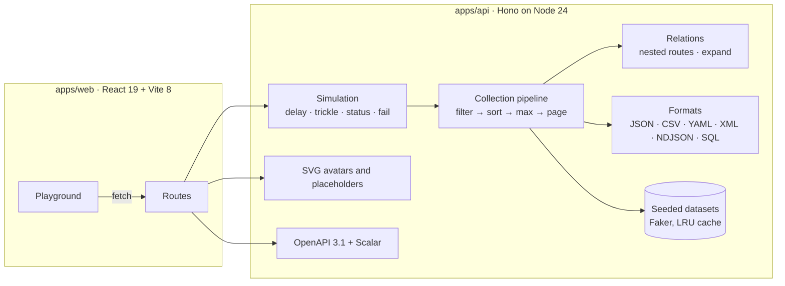

# Architecture



- **One pipeline.** Every collection, built-in or generated, goes through the same filter, sort, cap and page steps, so behaviour is identical everywhere.
- **Schemas first.** Routes are declared with Zod through `@hono/zod-openapi`; the OpenAPI document is generated from them and cannot drift from the code.
- **Deterministic by construction.** Datasets depend only on their seed, and the most recently used ones are cached in memory.
- **No build step for the API.** Node runs the TypeScript directly with type stripping.
- **Runs anywhere fetch does.** `createApp()` in `apps/api/src/core.ts` uses only web standards. `app.ts` adds the Node parts (logging and static files), and the GitHub Pages build loads the same app into the browser tab.

```
apps/api     Hono API: routes, collection pipeline, datasets, OpenAPI
apps/web     React playground: components, hooks, request builder
tests/e2e    Playwright tests that drive the playground against the real API
```

The shared site reads this repository’s guides and changelog alongside the public SDK in `apps/api`. Generated type comments live in their authoritative writer, `apps/api/scripts/docs-openapi.ts`; builds and example checks retain the native TypeScript 7 CLI. [Architecture and limits](docs/guides/architecture-and-limits.md) explains the entry and measurement boundaries.
